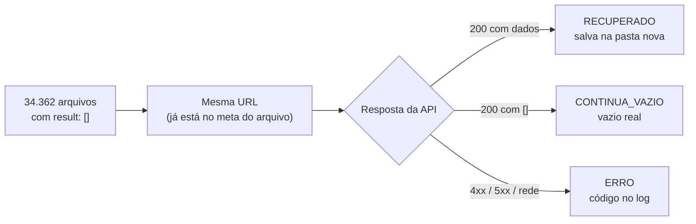

# Verificação dos arquivos vazios — dados educacionais do Piauí (SimCAQ)

> [!IMPORTANT]
> **Conclusão:** dos **34.362** arquivos vazios refazidos, **nenhum** voltou com dado. A API respondeu normalmente
> (HTTP 200) com lista vazia nos 34.362 casos. **O vazio é real, não foi falha de coleta**, e os arquivos que já temos
> estão corretos.

| Refeitos | Vieram com dado | Continuam vazios (HTTP 200) | Erros |
|---:|---:|---:|---:|
| **34.362** | **0** | **34.362** | **0** |

## Objetivo

Os datasets `dados_educacionais_basicos` e `dados_educacionais_basicos_microdados` foram coletados da API do SimCAQ
(`simcaq.c3sl.ufpr.br`) para municípios do Piauí, com um arquivo por consulta, organizado por categoria, fase, ano e
cruzamento. Alguns desses arquivos existem, mas estão com `"result": []`.

A pergunta era: **esse vazio é real ou a coleta falhou?**

O escopo foi mantido estreito de propósito:

- ✅ refazer a requisição **somente** dos arquivos que já existem com `[]`;
- ✅ guardar o que viesse com dado, na mesma organização e nomenclatura, e registrar o cruzamento;
- ✅ registrar o código HTTP de tudo que não viesse (404, 500, 413…);
- ❌ não testar cruzamentos novos, não fazer requisições de diagnóstico e não inventar arquivos que não existem.

## Como foi feito



1. **Levantamento** — listei os arquivos com `"result": []` nos dois datasets (`plano/plano_vazios.json`): 8.272 na
   básica e 26.090 na microdados. Cerca de 99% são da categoria `auxiliares`.
2. **Reexecução** — um workflow no GitHub Actions refez cada requisição, em 6 fatias, um job por vez, 8 threads e
   2 req/s, para não sobrecarregar a API.
3. **Registro** — cada arquivo gerou uma linha no log com status, HTTP, tentativas, tempo e URL.
4. **Consolidação** — o job final juntou as fatias em CSVs e num resumo.

| A API respondeu | Status no log | O que acontece |
|---|---|---|
| 200 com dados | `RECUPERADO` | salvo na pasta nova, na mesma organização do dataset |
| 200 com `[]` | `CONTINUA_VAZIO` | não grava; a API confirma que não há dado |
| 400 / 404 | `ERRO_HTTP_4XX` | não grava; código no log, sem nova tentativa |
| 500 / timeout / rede | `ERRO_HTTP_5XX` / `ERRO_REDE` | 4 tentativas com espera crescente; se persistir, código no log |

## Resultado

Execução de **28/10/2026** (run `40746741664`): todos os jobs concluídos com sucesso, cerca de 48 min por fatia,
4h47 no total. Nenhuma fatia parou antes do fim.

| Categoria | Básica | Microdados | Total | Recuperados |
|---|---:|---:|---:|---:|
| auxiliares | 8.192 | 25.862 | 34.054 | 0 |
| matriculas | 26 | 84 | 110 | 0 |
| docentes | 18 | 52 | 70 | 0 |
| turmas | 14 | 42 | 56 | 0 |
| escolas | 12 | 30 | 42 | 0 |
| funcionarios | 10 | 20 | 30 | 0 |
| **Total** | **8.272** | **26.090** | **34.362** | **0** |

Em todas as categorias e cruzamentos o resultado foi o mesmo: HTTP 200 com lista vazia.

### O que isso significa

- Os arquivos vazios que já existem nos datasets **estão corretos** e não precisam ser refeitos nem alterados.
- Não há nada para aplicar: o pacote `recuperados.tar.gz` saiu com 0 arquivos.

### O que este resultado não diz

Ele mostra que a API **não tem dado para essas consultas hoje**, mas não explica o motivo (por exemplo, se a categoria
não se aplica àquele município ou ano, ou se a API simplesmente não cobre). Investigar isso exigiria requisições de
diagnóstico, que ficaram fora do escopo.

## Onde ver os resultados

📄 **[docs/dados_nao_extraidos.md](docs/dados_nao_extraidos.md)** — o que continua sem dado, com os padrões observados
(`auxiliares`: 1.024 pares município × ano; demais categorias: só Nazária em 2007 e 2008).

📁 **[resultados/](resultados)** — cópia dos resultados no repositório:

- `continua_vazio_na_api.csv` — a lista completa dos 34.362 arquivos (a API respondeu 200 com `[]`)
- `resumo_por_cruzamento.csv` — por cruzamento: refeitos, recuperados, continuam vazios, erros
- `resumo.md` — totais por base, categoria e fase

O artefato bruto do workflow (com `log_vazios.jsonl`, uma linha por arquivo) fica em
**Actions → Refazer vazios → run `40746741664` → Artifacts → `vazios-consolidado`** e expira em 27/11/2026.

## Rodar de novo

**Actions → Refazer vazios → Run workflow.** Padrão: 6 fatias, um job por vez, 8 threads, 2 req/s (~5 h no total).
Se 25 falhas 5xx/rede seguidas ocorrerem, a fatia para sozinha.

Para aplicar um resultado no dataset local:

```
python refazer_vazios.py aplicar caminho\recuperados.tar.gz
```

Troca o arquivo vazio pelo recuperado e **nunca sobrescreve um arquivo que já tem dado**. `--dry-run` só conta.
Use `--raiz-basicos` / `--raiz-microdados` se os datasets não estiverem ao lado do script.

## Arquivos

- `refazer_vazios.py` — `planejar`, `executar`, `relatorio`, `consolidar`, `aplicar` (só biblioteca padrão)
- `refazer_lacunas.py` — motor de requisição reaproveitado (tentativas, limite de taxa, formato do arquivo)
- `plano/plano_vazios.json` — a lista dos 34.362 arquivos vazios
- `dados/_municipios_piaui.json` — os 224 municípios
- `.github/workflows/refazer_vazios.yml` — o workflow
